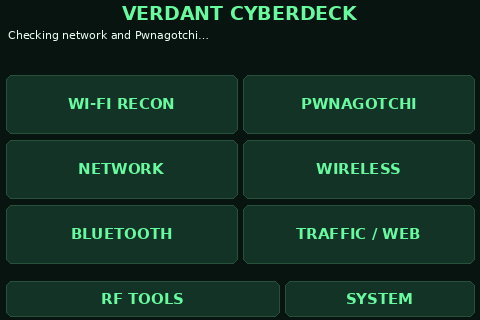
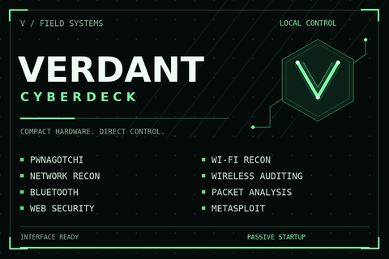
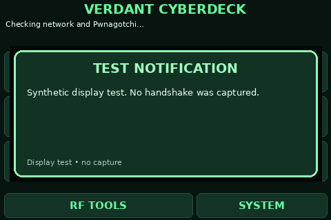

> **Installable package:** [Complete setup and distribution guide](docs/INSTALLABLE-PACKAGE.md). Run `bash install.sh --check` to inspect, or `sudo bash install.sh --complete` on the existing Pi. Fresh Pwnagotchi installation is an explicit separate profile and refuses an existing installation.

# Verdant Cyberdeck

**A passive touchscreen dashboard for a Raspberry Pi 400 running Kali Linux ARM64.**




Verdant Cyberdeck brings tool launchers, network diagnostics and controls for an **existing Pwnagotchi installation** into a compact dark interface. Opening the dashboard starts no wireless operations. The project was formerly named **Kali Cyberdeck 3.5**.

> **Development status:** software checks and offscreen rendering pass on the original host. Physical TFT/touch operation, live radio checks and Pwnagotchi runtime health remain unverified because the development terminal blocks device and system-bus access. The existing TFT launcher must explicitly release the display before direct framebuffer mode can run. This is an experimental project, not a hardware-certified appliance.

## Features

| Menu | Controls |
|---|---|
| Wi-Fi Recon | Adapter/connection status, explicit AP scan, signal/SSID sort, SSID, BSSID, channel, frequency, security, refresh and scrolling |
| Pwnagotchi | Existing installation detection; state-aware Open/Start; direct Stop/Restart; status, journals and read-only configuration summary |
| Network | Nmap, Bettercap and Metasploit launchers |
| Wireless | Aircrack-ng, Wifite, Kismet and monitor-capability diagnostics |
| Bluetooth | Controller/power status, explicit discovery, known-device information and bluetoothctl |
| Traffic / Web | tcpdump, TShark, Nikto, Gobuster and SQLmap launchers |
| System | Terminal, tmux, htop, interfaces/IP, CPU/memory, display diagnostics, logs and installation status |

Includes a persistent welcome screen with Enter Main Menu, large touch targets, Back/Main Menu controls on subpages, periodic status updates, error screens and bounded background commands. The desktop and optional framebuffer backends share the same 480×320 renderer.



## Requirements and limitations

The installer targets Kali Linux on ARM64/aarch64. The original host is a Raspberry Pi 400 with an already working 480×320 ILI9488 SPI TFT. **The project does not install or fix display drivers.**

The desktop backend needs an accessible existing graphical login and Tkinter/Pillow. The optional framebuffer backend additionally needs evdev input access and a free compatible TFT framebuffer. Tool installations and service authorization remain subject to the host's existing permissions.

On the original host, HDMI uses a separate 1920×1080 graphics device while the TFT is a 480×320 framebuffer used by an existing TFT launcher. A desktop fullscreen window alone does not move an application onto that TFT. Direct framebuffer mode refuses to run while the existing TFT/Pwnagotchi services are active or their state is unknown. It never stops those services automatically.

Interactive tool terminals use desktop Xterm. On a standalone TFT without an accessible desktop, on-screen help and diagnostics work where permissions allow; an embedded interactive terminal and onscreen keyboard are not implemented. Host-specific Pwnagotchi paths/service names and supported modes need review on other installations.

See the [full installation findings](docs/INSTALLATION-REPORT.md), [architecture](docs/ARCHITECTURE.md) and [test results](TEST-RESULTS.md).

## Install

Clone this private repository from your account, then run from its directory as your normal desktop user:

```bash
bash install.sh
```

The installer checks Kali/ARM64, reports the inherited session and framebuffer sizes, installs missing compatible repository packages, creates user launchers and its own graphical-login entry, compiles the code and runs an offscreen startup check. Apt may require your normal sudo authorization. Errors remain visible and are logged. No desktop environment, Pwnagotchi copy or display server is installed.

```bash
./run.sh                        # Existing graphical login session
./run.sh --self-test            # Offscreen menus and PNG generation; no radios
./run.sh --framebuffer          # Explicit direct TFT mode; ownership guards apply
```

After installation, `~/.local/bin/verdant-cyberdeck` is the preferred launcher. `kali-cyberdeck` remains a compatibility alias. The original installation at `/home/kali/kali-cyberdeck-35` is retained as a symlink to `/home/kali/verdant-cyberdeck`; new clones can use their own paths.

The existing desktop/autostart entry filenames remain `kali-cyberdeck.desktop` to avoid duplicate startup entries. Their displayed name is Verdant Cyberdeck. On a 480×320 desktop the interface is borderless; on larger desktops it is a fixed-size window. Escape returns to Main Menu; the desktop window manager can still close its window without stopping independent services. The TFT has no Exit control.

## Background capture, alerts and typography

[Background integration](docs/BACKGROUND-ALERTS.md) keeps the existing Pwnagotchi service running while the dashboard or normal terminal is foreground. A passive capture-event monitor delivers eight-second native overlays and always-on-top ordinary desktop notifications. The centered title is size 19; button labels are bold and one size larger. The splash now waits for Enter Main Menu. See [TFT controls](docs/TFT-CONTROLS.md) for the live screen, mouse fixes and login-password protection.

```bash
# Run from SSH/desktop; an active native terminal is restarted for its overlay.
sudo /usr/bin/python3 /home/kali/verdant-cyberdeck/scripts/integrate_tft.py \
  --apply --background-pwn --restart-terminal
```

The linked guide specifies the narrow, backed-up headless override/unit change, activation behavior, synthetic testing, window-manager limits and rollback. Main Pwnagotchi TOML, radio settings, plugins and learned data remain under the existing installation. Pwnagotchi is started only through its explicit controls, not by opening Verdant.



## Native TFT dashboard and AUTO mode

The [v2 native integration](docs/TFT-NATIVE-DASHBOARD.md) connects Verdant's real six-button dashboard to the existing TFT framebuffer/input supervisor. It preserves terminal/Pwnagotchi handoff and installs root-owned runtime modules, with verified backups and rollback.

```bash
sudo /usr/bin/python3 /home/kali/verdant-cyberdeck/scripts/integrate_tft.py --apply
```

Run from a normal Pi terminal. F1 returns from the current native application using its existing stop-current-app behavior; F3 previews the splash from the dashboard. Interactive tools use the existing `kali` terminal service. AUTO mode already selected by the earlier apply is preserved. Explicit mode selection remains available as `--pwn-mode auto`; boot enablement is unchanged.


The restricted execution session can prepare/test the patch but cannot apply root/systemd changes or certify physical TFT operation. See the linked ownership, rollback and validation notes.

## Pwnagotchi installation files

The repository includes [423 reviewed source/documentation files and 14 host-integration snapshots](pwnagotchi/README.md) from the existing installation. This includes its core Python, 25 built-in plugin files, custom TFT code, service units, wrapper and redacted configuration. Original GPLv3 and nested library notices are retained separately from Verdant's MIT license.

The first exporter omitted assets, translations, entry points and some auxiliary source/build files; this is an inspection snapshot, not a complete runnable distribution. See [the export review and corrected collection command](pwnagotchi/SOURCE-EXPORT.md). The configured custom-plugin directory does not exist on the exported host.

## Pwnagotchi preservation

This project **does not install, remove, overwrite or reconfigure Pwnagotchi**. It controls the original host's existing `pwnagotchi.service`, whose custom launcher uses `/root/pwnagotchi-modern` and requires `pwnagotchi-bettercap.service` and `pwngrid-peer.service`.

Start/Restart directly control the existing service and its radio dependencies. OPEN displays its actual live screen while it continues in the background. System and configuration pages now open directly without a password prompt. Desktop actions use the existing polkit agent through `pkexec`, without adding sudoers rules. Explicit framebuffer service handoff first releases the dashboard and then requires existing systemctl authorization. Configuration is shown read-only with credentials omitted. Keys, plugins, mode settings, learned data and network settings are not written.

An inaccessible service state is shown as **unknown**, never operational. Closing the dashboard does not stop Pwnagotchi. The original unit has no dependency on this project; live operational independence still needs host-side verification.

## Packages and startup

```bash
bash install-tools.sh --check   # Installed/available/unavailable report
bash install-tools.sh --install
bash autostart.sh status
bash autostart.sh enable
bash autostart.sh disable
bash uninstall.sh
```

The tool script covers the 14 requested Kali tool packages plus runtime dependencies. It does not include Pwnagotchi and refuses package-removal plans. Autostart uses the current graphical login environment, never a guessed DISPLAY value. Uninstall removes unchanged managed entries and restores previous entries from local backups; it preserves packages, source, logs, display drivers, boot configuration, SSH and network settings.

## Verification

```bash
python3 -m unittest discover -s tests -v
python3 -m compileall -q cyberdeck manage.py verify.py
for script in *.sh; do bash -n "$script"; done
./run.sh --self-test
python3 verify.py
# Explicit radio discovery, only with authorization:
python3 verify.py --hardware
```

Seventeen local tests passed in the initial implementation. The portable suite now contains 21 tests; a fresh clone skips the host-local preservation-manifest check. CI runs software checks without real radios or service changes. **CI results do not certify a physical display or running Pwnagotchi installation.**

See [recorded evidence](docs/evidence/) and [TEST-RESULTS.md](TEST-RESULTS.md) for successful and unavailable checks. Runtime logs and preservation manifests are generated locally under `logs/` and are not committed.

## Repository guide

- [Architecture](docs/ARCHITECTURE.md) and [historical installation report](docs/INSTALLATION-REPORT.md)
- [Contributing](CONTRIBUTING.md), [changelog](CHANGELOG.md) and [security reporting](SECURITY.md)
- [Authorized use](ACCEPTABLE_USE.md), [attribution and third-party notices](NOTICE.md), [MIT license](LICENSE)
- [Publication inventory and exclusions](docs/PUBLICATION.md)
- [Previous dashboard source](docs/legacy/previous-app.py.txt), retained as historical text

Use only within explicit authorization and agreed scope. This independent project is not endorsed by Kali Linux, Raspberry Pi, Pwnagotchi or other tool vendors. Its MIT license covers Verdant project material; the included Pwnagotchi source retains its original GPLv3 and nested licenses, and external tools retain their own terms. Review those tools' terms before redistribution.

## Automatic handshake preparation

The [daily handshake processor](docs/HANDSHAKE-PROCESSING.md) converts stable existing Pwnagotchi captures into one deduplicated `YYYY-MM-DD.22000` file per saved capture date and an Excel-compatible `handshakes.csv` inventory with capture, SSID/BSSID/client, type, record ID, conversion status and diagnostics. It runs independently of the dashboard, preserves originals, and starts no wireless operations or password-cracking jobs. Its separate root installer enables only the offline processing service.

## Battery, RF and PortaPack

The [battery/RF/Mayhem update](docs/BATTERY-RF-MAYHEM.md) adds change-driven redraws, cached fonts, an idle-aware native terminal, Pwnagotchi stats fonts +3 points, direct Settings/Configuration access, RF receive/transmit/protocol tools, isolated missing-tool builds and a Mayhem USB remote screen. The notification footer omits the expiry wording. Firmware update preparation uses the verified official release archive and never flashes implicitly. Hardware acceptance and source-tool builds require the host setup/device connection; see the guide’s precise validation limits.
